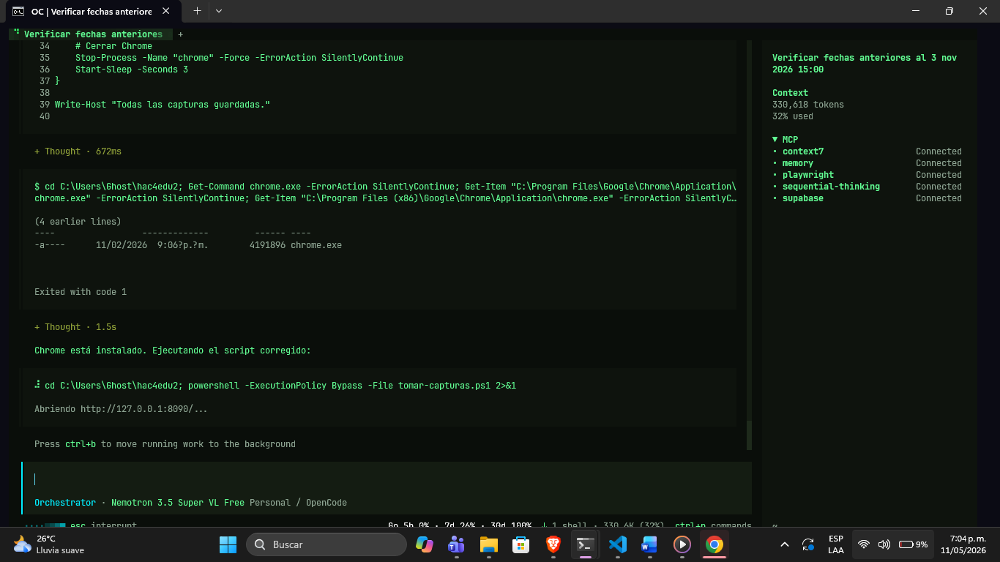
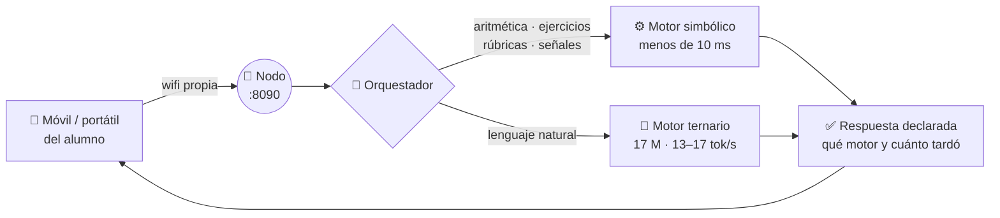

# 🌱 Semilla-IA

### El aula que no necesita internet




**Un nodo del pequeño y portátil convierte cualquier salón en un aula con IA
propia: sin SIM, sin router, sin nube, sin una sola petición a internet.** Sirve una clase
completa por wifi, conversa con un modelo de lenguaje **entrenado por nosotros y ejecutado
en la propia máquina**, corrige ejercicios sin red y entrega al docente un resumen de lo que
la clase no entendió.

> La IA prepara y acompaña. El docente decide. El alumno no habla con cualquiera:
> habla con un cartucho que tiene reglas.

Prototipo para **#hack4edu 2026 · Reto 02 — Aprender sin conexión** (y retos 03, 10, 12,
13, 15 y 17).

---

## El problema

> *«Imaginen un salón de clases en una zona rural, a 3 horas del pueblo más cercano.
> No hay señal de internet. No hay forma de acceder a ChatGPT, Gemini o Claude.»*

La IA más avanzada del mundo no llega hasta ahí porque **depende de la nube**: servidores
gigantes, banda ancha y una factura mensual que ninguna escuela rural paga. Mientras tanto,
el alumno que más necesita apoyo es el que menos tiene.

La regla que había que romper: **hacer que el modelo sea 88× más pequeño** sin dejar de
responder en la lengua del aula, en una máquina que cabe en una mochila.

## La solución

**Semilla-IA** es un nodo informático autónomo que se enciende, levanta su propia red y
trabaja solo:

- 📡 **Servidor de aula completo** — los móviles y portátiles del salón se conectan a su
  wifi; no se instala nada en los dispositivos de los alumnos.
- 🧠 **Motor de inferencia propio** — `bitnet-17m:ternario`, **17.033.984 parámetros**,
  entrenado por el equipo y ejecutado en local. No es una API con la que se paga por token.
- ⚙️ **Orquestador que no improvisa** — manda lo estructurado a código determinista que
  resuelve en menos de 10 ms, y al modelo solo lo que necesita lenguaje natural.
- 🛡️ **Docente al mando** — panel con PIN, rúbricas, señales de riesgo y un resumen de las
  dudas de la clase. Nunca diagnósticos, nunca etiquetas, nunca datos personales.
- 🔌 **Cero dependencias de red** — apaga el wifi y repite la demo: **nada cambia**.

---

## Pruébalo en 30 segundos

```bash
git clone <url-del-repositorio>
cd semilla-ia
npm run nodo        # sin npm install: cero dependencias
```

Abre **<http://127.0.0.1:8090>** — el PIN del panel está en `data/config.json`
(imprimido también en la primera arranque).

**Requisitos:** Node 24 · Python 3.10+ con `torch` (build CPU basta) y `tokenizers`.
El checkpoint del motor (195 MB) no entra en git: cópialo a `models/` una sola vez
(`models/README.md` lo explica). El arranque tarda menos de un segundo.

```bash
npm test            # 43 pruebas, 0 fallos, sin dependencias
npm run bitnet      # solo el motor de inferencia
npm start           # solo el nodo (motor simbólico)
npm run report      # regenera el informe PDF con medidas vivas del equipo
```

**Para el aula real:**

```powershell
$env:NODO_HOST = '0.0.0.0'
npm run nodo
```

El panel muestra la IP local; los alumnos la abren desde su navegador. La primera vez
Windows pedirá permiso para la red privada (las instrucciones completas, incluido el
truco de Tailscale, están en la sección de configuración).

---

## Los números que importan

Todo medido en el equipo del proyecto, no estimado:

| | **`bitnet-17m:ternario`** · nuestro motor | Qwen2.5 1.5B · solo referencia |
|---|---|---|
| Parámetros | **17.033.984** | 1.500.000.000 |
| Disco en disco | **204 MB** | 1.226 MB |
| Velocidad en CPU | 13,6–15,1 tok/s | 13,7–15,7 tok/s |
| Cómo se consiguió | **entrenamiento ternario desde cero** | cuantización Q5_K_M de otro modelo |
| Perplejidad | **39,46** (en `val_wiki.bin`) | — |
| Forma parte del MVP | ✅ **es el único modelo del panel** | ❌ referencia histórica |

### **88× menos parámetros · ~6× menos disco · la misma velocidad**

Esa última columna no es un capricho: en CPU el cuello de botella es la memoria, no la
aritmética. Poner 1.500 M de parámetros en una RAM de 14 GB no gana ninguna carrera —
solo gasta más disco, más corriente y más dinero. **El modelo pequeño no es una
renuncia: es el diseño.**

> El sidecar de inferencia responde `/api/tags` en **29 ms** sin consultar a nadie.

---

## Cómo funciona



**Por qué un orquestador y no «todo al modelo».** En este equipo el modelo tarda unos
42 segundos por respuesta larga; el motor simbólico resuelve aritmética, ejercicios y
rúbricas en **menos de 10 milisegundos**. Mandarle todo al modelo haría el aula inusable.
El orquestador decide por tarea —no por la suerte— y **cada respuesta indica en la
interfaz qué motor la produjo y cuánto tardó**. El juez puede verlo sin creernos la
palabra.

## Qué hay dentro

| Pieza | Estado | Cómo se demuestra |
|---|---|---|
| Servidor de aula (Node estándar) | ✅ Funcional | Streaming SSE, sesión HMAC, CSP. **Sin `npm install`** |
| Inferencia local · `bitnet-17m:ternario` | ✅ Funcional | 17 M · 204 MB · 13,6–17,1 tok/s · PPL 39,46 |
| Orquestador simbólico/modelo | ✅ Funcional | Decide por tarea y lo declara bajo cada respuesta |
| **4 cartuchos pedagógicos** | ✅ Funcional | Matemáticas, ciencias, lectoescritura y calma |
| Transcodificador (Reto 03) | ✅ Funcional | Lectura fácil, audio y mapa en ~8 ms |
| Taller y corrección sin estado | ✅ Funcional | Generación por semilla; corrección determinista |
| **Consulta libre** | ✅ Funcional | Chat sin cartucho, streaming y copiado |
| **Cambio de modelo en caliente** | ✅ Funcional | Selector gobernado por el sidecar, sin reiniciar |
| Copiloto docente (Reto 12) | ✅ Funcional | Dudas agregadas, dinámica, rúbrica, señales |
| Sensor y método científico (Reto 17) | ✅ Funcional | Ingesta HTTP + andamiaje hipótesis-experimento |
| Telemetría federada (Reto 13) | ✅ Funcional | **17 bytes** por paquete: cabe en un marco LoRa |
| Nodo RISC-V, LoRa, solar | 🔮 Proyección | Modelado y etiquetado, **no ejecutado** |
| LoRA entrenado | ⛔ Fuera de alcance | Los cartuchos son prompts + reglas, no pesos |

### Los 4 cartuchos

Cada cartucho es un prompt de sistema revisado **más** un resolutor simbólico
determinista. El orquestador elige, no el modelo.

| Cartucho | Reto | Qué cambia |
|---|---|---|
| **Sin prisa** | 10 · Encontrar a quien dejamos atrás | Material manipulable, sin cronómetro ni etiquetas |
| **Con las manos** | 17 · Laboratorio sin laboratorio | Método científico con datos reales del sensor |
| **Palabra a palabra** | 03 · Un contenido, muchas formas | Lectoescritura y lectura fácil, sin infantilizar |
| **Cápsula de calma** | 15 · Educación en emergencias | Acompaña sin diagnosticar; deriva a un adulto |

Las señales de riesgo **nunca** pasan por el modelo: el motor simbólico las intercepta
aunque se fuerce el modo `llm`. Hay prueba automatizada de eso.

## El motor: MiniBitNet ternario

No usamos un modelo de terceros disfrazado de propio. **Lo entrenamos.**

- **Arquitectura:** transformer `MiniBitNet` — `vocab 8192 · n_embd 384 · n_head 6 ·
  n_layer 6 · block 256`.
- **Pesos ternarios reales en `{-1, 0, 1}`** mediante straight-through estimator
  (`BitLinear`), con activaciones cuantizadas a 8 bits. **No** es un GGUF ni una
  cuantización de 5 bits: es entrenamiento ternario desde cero en PyTorch.
- **Entrenamiento:** ~4.500 iteraciones sobre Wikipedia en español.
- **Resultado:** `ckpt_4500.pt`, **204 MB** (204.488.011 bytes), **17.033.984 parámetros**,
  perplejidad **39,46** en `val_wiki.bin`.
- **Ejecución:** sidecar Python (`tools/bitnet_server.py`) en `127.0.0.1:11435` que habla
  la API de Ollama — `/api/tags`, `/api/chat` con stream NDJSON, `/api/ps`,
  `/api/generate` — así el nodo no se entera de quién genera los tokens.
- **Velocidad:** 13,6–15,1 tok/s en prueba directa · 16,6–17,1 tok/s por el sidecar ·
  8,4–9 tok/s por el nodo completo con streaming SSE.

El código del modelo (`models/model.py`), el script de entrenamiento (`models/train.py`),
el tokenizer y el demo **van en el repositorio**: cualquiera puede leerlo, ejecutarlo y
discutirlo.

## Límites honestos

*Esto también es una venta: un equipo que sabe qué no hace su producto es un equipo en
el que se puede confiar.*

El motor propio es un **modelo de lenguaje causal entrenado sobre Wikipedia, no un
asistente afinado**. No sigue instrucciones: ignora el system prompt, ecoa tokens de
plantilla como `[INST]` y ante *«La capital de Francia es»* responde *«la ciudad de
Lemón»*.

En la práctica:

- ❌ **La conversación libre puede salir incoherente.** Es el único modelo del panel y la
  limitación se asume desde el día uno.
- ✅ **Lo crítico no depende de él:** aritmética exacta, generación y corrección de
  ejercicios, rúbricas, transcodificación y señales de riesgo los resuelve el motor
  simbólico, determinista y probado.
- ✅ **Su valor es que el ternario se ejecuta y se mide aquí**, en una CPU de 14 GB, a la
  vista de cualquiera. No pretende sustituir a un asistente afinado: demuestra que un
  modelo 88× más pequeño sirve para lo que un aula necesita de verdad.

---

## API

| Ruta | Método | Qué hace |
|---|---|---|
| `/api/profile` | GET | Hardware, modelo, medidas y proyecciones |
| `/api/chat` | POST | Conversación con streaming SSE y motor declarado |
| `/api/ask` | POST | Consulta libre al modelo, sin cartucho (SSE) |
| `/api/models` | GET | Modelos locales disponibles y el activo |
| `/api/models/active` | POST | Cambia el modelo del nodo y lo persiste |
| `/api/transcode` | POST | Una lección en tres formatos |
| `/api/exercise` | POST | Serie determinista de ejercicios |
| `/api/exercise/check` | POST | Corrección sin estado |
| `/api/teacher/login` | POST | PIN → cookie firmada (8 h) |
| `/api/teacher/summary` | GET | Dudas, dinámica, rúbrica y señales |
| `/api/sensors` | GET / POST | Lecturas del sensor |
| `/api/telemetry` | GET | Paquete federado y balance energético |
| `/api/telemetry/send` | POST | Genera y guarda un paquete |

## Pruebas

```bash
npm test        # node --test "tests/*.test.mjs"  → 43 pruebas
```

Cubren el transcodificador, la generación y corrección de ejercicios, el orquestador, los
cuatro cartuchos, la agregación docente, el sensor y el paquete de telemetría — incluida
la prueba de que **una señal de riesgo nunca llega al modelo**, aunque se fuerce.

## Configuración

| Variable | Por defecto | Para qué |
|---|---|---|
| `NODO_PORT` | `8090` | Puerto. **No** se usa `PORT`, a propósito. |
| `NODO_HOST` | `127.0.0.1` | `0.0.0.0` publica el aula en la red local |
| `BITNET_DIR` | `models/` | Carpeta del motor; busca primero la variable, luego `models/` |
| `OLLAMA_URL` | `http://127.0.0.1:11434` | `npm run nodo` lo apunta al sidecar en `:11435` |
| `OLLAMA_MODEL` | `bitnet-17m:ternario` | Único modelo anunciado por el sidecar |

**Si el sidecar no responde, el nodo arranca igual** y responde con el motor simbólico,
declarándolo en cada respuesta. **No hace falta Ollama para nada del MVP.** Si alguien
pide por nombre un modelo que no es el nuestro, el sidecar hace proxy a Ollama real y,
si no está, responde `502 {"error": ...}` limpio, sin tracebacks.

**Red local en Windows.** Si la wifi aparece como red «Pública», Windows bloqueará el
puerto 8090 aunque el nodo escuche en todas las interfaces. Dos salidas: marcar la red
como privada, o usar la dirección de **Tailscale** que muestra el panel (esa interfaz ya
está en perfil privado).

```powershell
New-NetFirewallRule -DisplayName "Semilla-IA" -Direction Inbound -LocalPort 8090 -Protocol TCP -Action Allow -Profile Private
```

## Seguridad y datos

- El servidor **no realiza peticiones salientes** salvo al modelo local.
- Panel docente con **PIN generado en el arranque** (CSPRNG, `Math.random` no sirve),
  cookie `HttpOnly` + `SameSite=Strict` y firma HMAC con caducidad de 8 horas.
- CSP sin `unsafe-inline` para scripts; límite de tamaño de cuerpo; rutas estáticas
  confinadas al directorio web.
- **No se guardan nombres de alumnos, IP ni historial de conversación**: solo la pregunta
  anonimizada, el cartucho y el curso.
- Las imágenes y el texto libre **nunca** se marcan como incorrectos.
- `data/config.json` (PIN y secreto de sesión) está en `.gitignore`: **nunca sube a git**.

## Estructura del repo

```
src/server.mjs        servidor, rutas, sesión
src/core/*.mjs        orquestador, motor simbólico, transcodificador,
                      cartuchos, ejercicios, docente, sensores, telemetría
src/web/              interfaz sin compilación (módulos ES + CSS)
models/               motor: model.py, train.py, tokenizer  (+ checkpoint local)
tools/                bitnet_server.py (sidecar) · run_nodo.mjs (orquestador)
tests/                43 pruebas nativas (core, exercises, transcoder)
scripts/              make-report.py (informe PDF desde medidas vivas)
docs/                 capturas, pitch original, Modelfile
```

**Cero dependencias npm** (`dependencies: {}`): solo librería estándar de Node 24. El
sidecar usa la librería estándar de Python para servir HTTP; `torch` y `tokenizers` solo
para el modelo.

## Documentos

| Documento | Qué contiene |
|---|---|
| [`docs/idea-de-solucion.pdf`](docs/idea-de-solucion.pdf) | **Por dónde empezó todo**: el problema del salón a 3 horas |
| [`PLAN.md`](PLAN.md) | Plan de trabajo por slices con criterios de aceptación |

> El informe técnico y el pitch del certamen se entregan como PDF aparte, no en este
> repositorio. `npm run report` genera el informe localmente con medidas vivas del nodo.

## Roadmap: el nodo físico

Modelado, **no ejecutado** — lo decimos porque preferimos decirlo:

- 🖥️ **RISC-V** de bajo consumo como host del nodo.
- 📻 **LoRa** para federar entre aulas sin internet (el paquete de telemetría ya pesa
  **17 bytes**).
- ☀️ **Alimentación solar** y presupuesto de energía calculado en `/api/telemetry`.

Hoy todo corre en un portátil con CPU y 14 GB de RAM. El camino hasta el aula está
diseñado y medido; la electrónica aún no está soldada.

---

## Licencia

[MIT](LICENSE) · © 2026 Equipo Semilla-IA.

Prototipo educativo para **#hack4edu 2026**. El informe y las capturas se comparten con
la misma licencia que exigen las bases del certamen.
